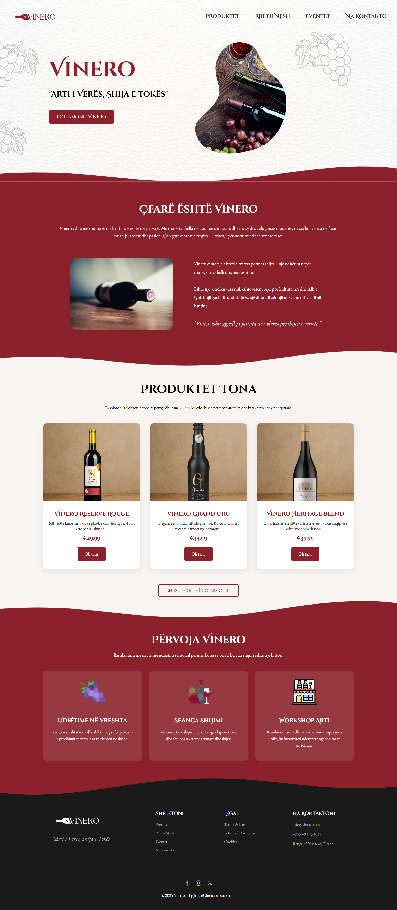
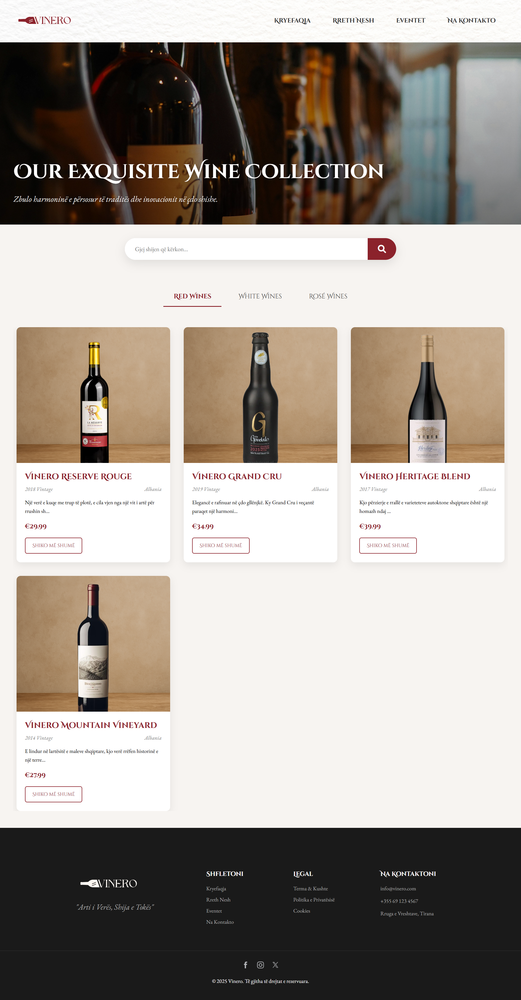
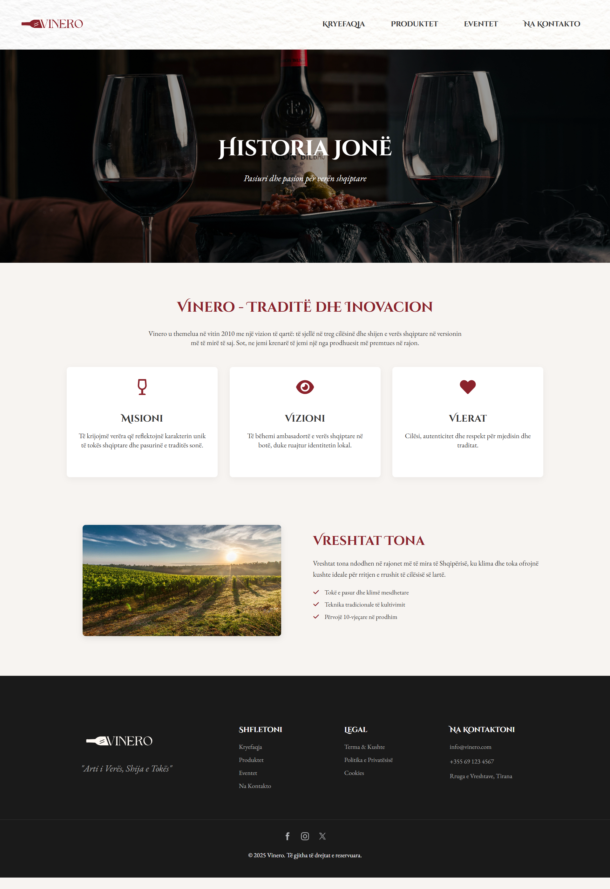
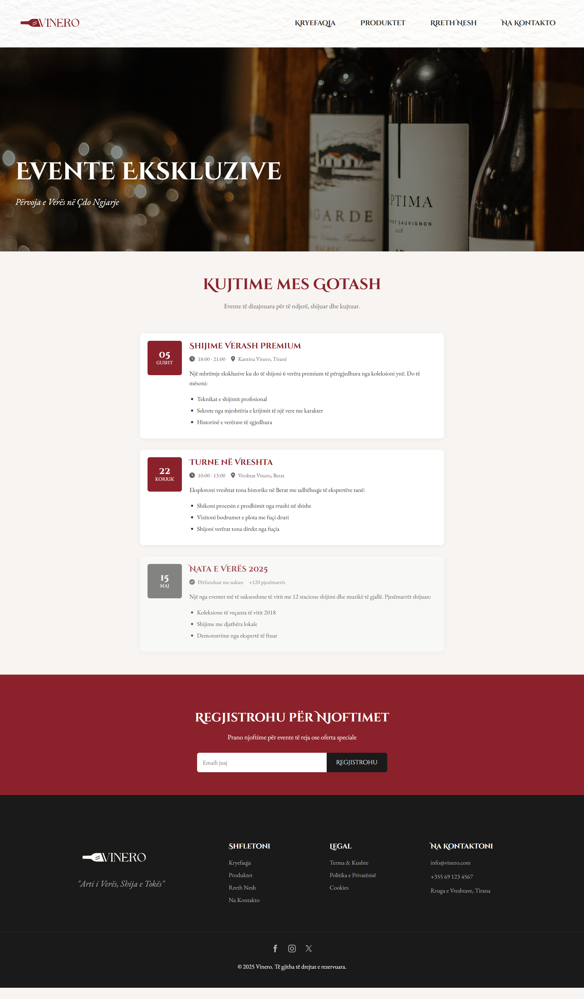
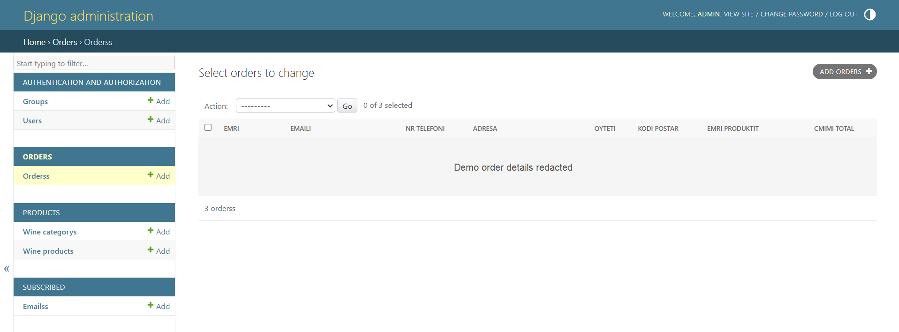

# Vinero

Vinero is a Django-powered wine storefront prototype. It brings together a responsive, Albanian-language storefront with product listings, winery information, events, and a basic order-submission flow.

> **Project status:** This is a portfolio/demo project, not a production-ready online shop.

## Features

- Homepage featuring wines and winery information
- Product catalogue backed by Django models
- Winery/about and events pages
- Checkout form that stores submitted orders in the database
- Django Admin for managing products, categories, and orders
- Newsletter email submissions stored in the database

## Tech stack

- Python and Django
- Django REST Framework (installed; the current site is server-rendered)
- SQLite for local development
- HTML, CSS, and JavaScript
- Pillow for product image uploads

## Requirements

- Python 3.13 or later
- PowerShell on Windows (commands below use PowerShell syntax)

## Run locally on Windows

Open PowerShell in the project root, the directory containing `README.md`, then create and activate a virtual environment:

```powershell
py -3.14 -m venv .venv
.\.venv\Scripts\Activate.ps1
```

If Python 3.14 is not installed, install a supported Python version first. For example, with the Python install manager:

```powershell
py install 3.14
```

Install the dependencies:

```powershell
python -m pip install Django==5.2.3 djangorestframework==3.16.0 Pillow
```

Apply the database migrations and start Django:

```powershell
python .\vinero_backend\manage.py migrate
python .\vinero_backend\manage.py runserver
```

Open <http://127.0.0.1:8000/> in your browser. Stop the development server with **Ctrl+C** in the terminal.

If you do not want to activate the virtual environment, run Django directly with:

```powershell
.\.venv\Scripts\python.exe .\vinero_backend\manage.py runserver
```

## Pages

| Page | Local URL |
| --- | --- |
| Home | <http://127.0.0.1:8000/> |
| Products | <http://127.0.0.1:8000/products/> |
| Events | <http://127.0.0.1:8000/events/> |
| About | <http://127.0.0.1:8000/rreth-nesh/> |
| Checkout | <http://127.0.0.1:8000/checkout.html> |
| Django Admin | <http://127.0.0.1:8000/admin/> |

## Screenshots

| Home | Products |
| --- | --- |
|  |  |
| <br>About | <br>Events |
| <br>Django Admin (order data redacted) | |

To sign in to Django Admin, create a local administrator account:

```powershell
python .\vinero_backend\manage.py createsuperuser
```

Add wine categories and products in Admin to populate the catalogue. Product records require an image.

## Useful development checks

Run Django's project checks and tests with:

```powershell
python .\vinero_backend\manage.py check
python .\vinero_backend\manage.py test
```

Check whether model changes need new migrations with:

```powershell
python .\vinero_backend\manage.py makemigrations --check --dry-run
```

The current product models differ from their recorded migration, so this last command reports pending migration changes. Review and reconcile the model/migration history before relying on those changed fields or preparing a production database.

## Project layout

```text
frontend/                 HTML templates, CSS, and image assets
vinero_backend/
  manage.py               Django management entry point
  vinero_backend/         Django settings and URL configuration
  products/               Wine categories and products
  orders/                 Order records and checkout handler
  subscribed/             Events page and newsletter submissions
```
